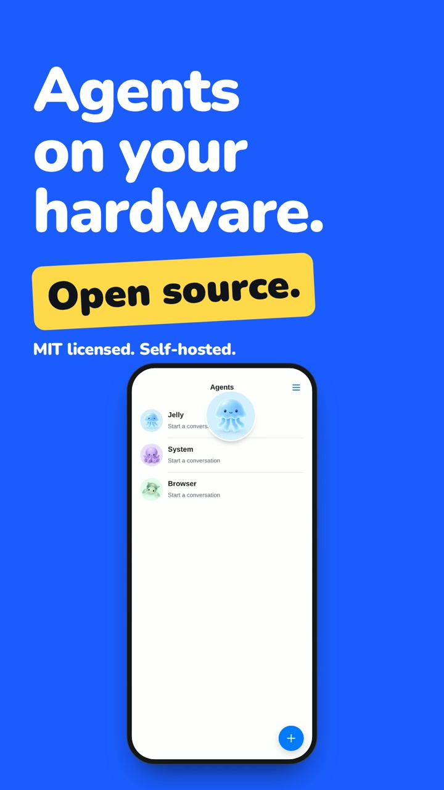

# Jelly

**Jelly is a local multi-bot agent system**

The target user is someone building an running there whole business from a single VM (inspired by https://x.com/levelsio).

<p align="center">
  <a href="https://dctanner.github.io/jelly/">
    
  </a>
  <br>
  <a href="https://dctanner.github.io/jelly/">Watch the 29.5-second launch reel</a> · <a href="https://dctanner.github.io/jelly/media/jelly-mobile.mp4">MP4</a>
</p>

Real mobile UI with demonstration data and an original soundtrack; sudo execution and website sign-in are simulated.

- Run it on your on hardware: a Mac, Linux box or VM.
- Create as many agents as you want. Group into project directories.
- Access the web UI locally, or setup Tailscale and use from your laptop or phone (add it to your iPhone home screen and it feels like a native app).
- Use your existing ChatGPT subscription or API key.
- Agents can use your local Chrome browser. If the agent needs to login somewhere, you can take control of the browser anytime (using VNC in the web UI).
- If an agent needs sudo access, it can securely request it from you.
- Includes all the features you'd expect from an agent: shell tools, subagents, and MCP connections, file uploads, inline images, downloadable artifacts etc.
- Built with Bun, React, SQLite, and the [Pi agent harness](https://github.com/earendil-works/pi).

## Trusted Apps

Apps is an iframe-only launcher for independently hosted apps. Choose **Apps → Add app** and supply a name and browser-reachable HTTP(S) URL. Same-host different-port and Tailscale URLs work without rebuilding or adopting their services. Stars are explicit; history, icons, descriptions and attribution are retained. Every viewer has **Back to Apps**, retry/edit and honest framing/login guidance.

**Only add apps you trust.** Same-host app servers may receive or interfere with Jelly cookies, including HttpOnly cookies; Tailscale protects network access, not app isolation. Jelly keeps session/CSRF and exact control-origin checks and stays unframeable. Registration does not verify embedding or availability, and removal never stops the app. See [Apps](docs/APPS.md).

## Browser notifications

Opt in at **Settings → Browser notifications** for alerts when an agent finishes
or needs attention. Clicking an alert opens its conversation; no message contents
are exposed. Keep Jelly open, using HTTPS or localhost (plain HTTP Tailscale
addresses cannot notify). See [setup and limitations](docs/NOTIFICATIONS.md).

## Subagent progress

Delegated work appears in live, expandable cards in the conversation. Open a
card to inspect its task, activity, available thinking summaries, messages and
tool calls/results. Completed cards remain in history.

Jelly keeps the parent interactive while async children work and gives its model
a compact status checkpoint approximately every five minutes. Supervisor requests
and completion notifications use Pi's native delivery. Explicit foreground calls
remain supported, but a checkpoint cannot interrupt an open tool.

Transcripts show finalized, provider-exposed content—not hidden reasoning.
Expired artifacts and forked sessions without a safe inherited-context boundary
are explicitly unavailable. See [architecture](docs/ARCHITECTURE.md#subagent-observability).

## Browser and patch tools

**Connected Chrome is the only browser integration.** Install the Chrome extension
and native host, then select a profile and site scope in **Settings → Connected Chrome**.
Agents use separate task tabs in your existing signed-in profile; cookies and accounts
are shared. There is no managed Chromium, Playwright/AgentBrowser controller, or fallback.
See [setup, privacy and limitations](docs/CONNECTED-CHROME.md).

Agents can inspect bounded visible text and exact element references, click/fill
non-secret fields, manage their task tabs, scroll and wait for text/readiness.
References expire on navigation, tab changes and handoff. Use private browser
sign-in for credentials; coordinate clicks, free typing, uploads and diagnostics
are not exposed as browser tools.

`apply_patch` adds Codex-style multi-file add/update/delete/move patches on both OpenAI API and ChatGPT, alongside unchanged Pi `edit`/`write`. It requires exact unique context and rejects symlinks, hardlinked sources and unsupported text. Paths are not sandboxed. Preflight checks the whole patch, but filesystem writes are **not transactional**: failures can leave partial changes, reported in a mutation ledger. Limits are 1 MiB per patch/file, 64 operations and 16 MiB combined working set.

`bun run check:full` includes Chrome bridge/tool tests, patch filesystem tests and
local provider-transport tests. `bun run test:chrome` additionally exercises the
extension in disposable Chrome profiles.

## Quick start

Requires [Bun](https://bun.sh) **1.3.9+** and **Node.js 24+** (for subagent runners and CLI dependencies). Connected Chrome supports Linux and macOS; sudo handoffs require Linux.

```sh
git clone https://github.com/dctanner/jelly.git
cd jelly
bun install
bun run dev
```

Open **http://127.0.0.1:5173**. **A ChatGPT subscription or OpenAI API key is required to run agents.** Connect your account or add a key in Settings before sending a message. Automatic mode prefers ChatGPT, then an API key; there is no no-key demo mode. Model availability depends on your account.

Select a **Fast** variant of any model in Settings → Model or the composer's model
menu to request priority processing with `service_tier: "priority"`. Availability
depends on your account; higher API pricing applies.

Select **GPT-6 Astra Ultrafast** in the same menus
for eligible ChatGPT subscriptions (Pro 500 or Enterprise) or OpenAI API access.
This requests Astra with `service_tier: "ultrafast"`; standard Astra remains the
default. [Ultrafast has higher API pricing and separate limits](https://developers.openai.com/api/docs/guides/ultrafast-mode).
Account-access errors are surfaced rather than silently falling back to standard.
Both speed selections cover chat turns, tool continuations, naming, and compaction;
Pi subagents still use their own service-tier settings (they inherit the upstream
model and effort, not Jelly's Fast or Ultrafast selection).

Optional environment settings are documented in [`.env.example`](.env.example). Put local values in `.env.local`, which is ignored by Git. Set `FIRECRAWL_API_KEY` to enable web search and fetching.

### Production

```sh
bun run build
bun start
```

Open **http://127.0.0.1:3100**. Stop development first; both modes use API port 3100 by default. Production has no hot reload—restart after code changes when agents are idle. Development backend reloads interrupt active runs; set `JELLY_WATCH_API=0` to disable them.

`JELLY_TAILSCALE=1 bun start` adds native HTTP listeners on discovered Tailscale addresses alongside loopback. `bun run dev:tailscale` uses native Vite listeners and its HTTP/WS loopback API proxy. Neither uses raw TCP forwarding nor LAN/wildcard listeners.

For an installed service, `scripts/restart-when-idle.sh` waits up to 30 minutes for
zero running agents and no restart holds, then restarts and checks loopback and
private Tailscale HTTP. On macOS it reads the port and data directory from
`/Library/LaunchDaemons/com.jelly.server.plist` and restarts
`system/com.jelly.server`. Run it from a separate terminal outside Jelly:

```sh
sudo /bin/bash scripts/restart-when-idle.sh
```

On Linux, schedule the helper in a separate systemd user unit; it restarts
`jelly.service`. See the [service restart details](docs/APPS.md#jelly-activation-helper).
Direct service-manager restarts bypass this helper's idle checks.

Development serves only frontend source and assets; instance data, server source, and other repository files are not downloadable through Vite. Keep credentials and private files out of `public/`, `src/client/`, `src/shared/`, and `node_modules/`.

ChatGPT sign-in uses a one-time device code. Open the approval link shown in Settings, enter the code, and Jelly connects automatically. This works over Tailscale without a localhost redirect. If needed, enable device-code login in your ChatGPT security settings or ask your workspace admin.

### Native Mac desktop (Peekaboo)

Settings → **Tools → Native Mac desktop** configures an external signed Peekaboo
CLI/app and an exact Bridge socket, separately from browser tools. Desktop control
starts off and requires exact application grants. The official unmodified 4.9.0
releases support scoped AX observation, consented exact-window screenshots and
native snapshot-bound background input according to available host permissions
and capabilities. No Peekaboo rebuild is required. See
[setup, privacy and recovery](docs/PEEKABOO.md).

### Connected Chrome private sign-in

Follow [Connected Chrome setup](docs/CONNECTED-CHROME.md). Sign in privately in
local Chrome, or use its human-only web VNC viewer on supported Linux desktops.
The viewer controls the connected desktop, never exposes pixels or clipboard
contents to agents, and requires explicit handback before browser tools resume.
Native Mac desktop tools remain a separate, application-granted capability.

### Administrator commands

Agents can use `request_sudo` to run commands with root privileges—for example, to install packages or manage system services. If your sudo policy permits, the command runs immediately. Otherwise, Jelly shows the command for review and asks for your password in a private authentication card, never in chat. The password is not sent to the model or saved by Jelly.

Requires Linux, `sudo` with askpass support, and `/usr/bin/python3`.

## Security and local data

**Jelly is a trusted-user tool, not a sandbox.** Agents can execute shell commands and access files with your OS user's permissions, without per-tool approval. Sudo commands run immediately when your policy permits; otherwise Jelly requests private authentication.

Keep Jelly on loopback or a trusted Tailscale network. Do not expose it directly to the public internet. Anyone with network access to the app may gain control of its tools. `bun run dev:tailscale` enables private tailnet access.

Conversations, credentials, browser profiles, and artifacts live in `.jelly/` by default. User-wide MCP configuration and OAuth caches live in `~/.jelly/`. Neither belongs in source control. Stop Jelly before backing up its instance data. Model conversations are sent to your chosen provider; local storage does not mean local inference.

## Development

```sh
bun run check        # Fast TypeScript-only check for everyday commits
bun run check:full   # TypeScript, all tests, and both builds before deployment
```

Tests use temporary data and deterministic fixtures; no paid model calls are required. See [architecture](docs/ARCHITECTURE.md), [design](docs/DESIGN.md), and the [roadmap](ROADMAP.md).

## License

[MIT](LICENSE). Bundled fonts and dependencies retain their own licenses, including noVNC (MPL-2.0).

## Automatic agent names

The top-left **+** immediately creates and opens **New Agent**, without a form.
It inherits the current project (or gets a private workspace outside a project).
Before the first message, click the centered name or avatar to edit it in place.
Name edits save with Enter or on blur (Escape cancels); avatar changes save when selected.
After the first message, the pill moves to the header and opens the profile edit form
directly. The separate options button still exposes workspace and agent actions.
When its first message is sent, Jelly makes
one small, tool-free OpenAI request through the selected ChatGPT subscription or
API connection to suggest a sea-themed name related to that message. The new name
appears in the agent list and conversation header before the agent begins work.

Editing and saving the name before sending the first message opts out—even if you
change it back to **New Agent**. Editing only instructions or the avatar does not.
Existing agents retain their names. Naming failures/timeouts keep **New Agent** and
do not stop the task or retry the naming request on subsequent messages.

### Agent browser sessions

Agents have exclusive task-tab capabilities within the selected Connected Chrome
profile, not independent cookies or browser profiles. Existing task sessions keep
their selected profile and scope until closed. Disconnected profiles fail closed;
Jelly never starts a managed browser as a fallback. Legacy managed-browser profile
data is left untouched on disk, but is no longer opened or used.

Stop cannot undo navigation, clicks or other website effects already issued.
